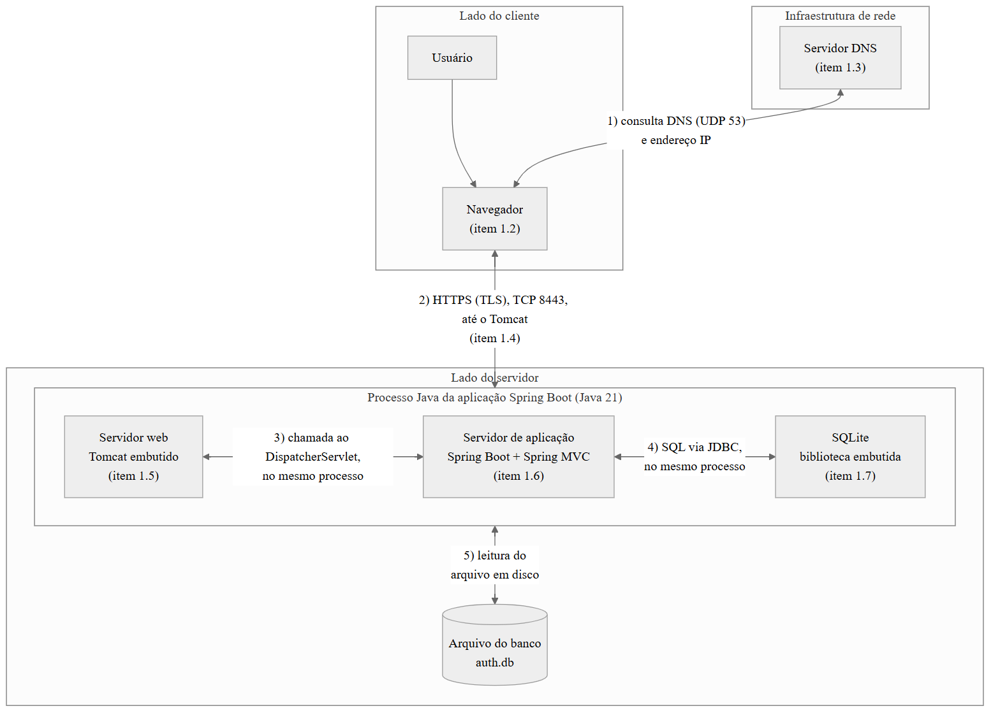

# 1 Ambiente operacional de uma aplicação Web
 
Esta seção descreve o ambiente operacional envolvido na execução de uma aplicação Web, isto é, o conjunto de softwares de apoio que participam do processamento de uma requisição, do navegador do usuário até o banco de dados. Para cada componente, explica-se como ele é invocado e quais resultados produz. A descrição adota a mesma pilha tecnológica do software projetado na Seção 2 (itens 2.1.4 e 2.1.6): no lado do cliente, um navegador moderno, como o Google Chrome; no lado do servidor, uma aplicação Spring Boot 4.1, executada em Java 21, com o servidor Tomcat 11 embutido, que atende as requisições diretamente por HTTPS, e o SQLite 3 como sistema gerenciador de banco de dados embutido. Como fio condutor, utiliza-se a própria requisição de autenticação do software projetado, POST /api/login (item 2.1.5). O item 1.1 apresenta a visão geral do ambiente; os itens 1.2 a 1.7 detalham cada componente (navegador, DNS, protocolos HTTP/HTTPS e TLS, servidor web, servidor de aplicação e SGBD); e o item 1.8 reúne tudo no fluxo completo de processamento de uma requisição.
 
## 1.1 Visão geral do ambiente operacional
 
**Autor(a):** Rafael F. da Silva · **Revisor(a):** Caique Duarte · **Referências:** (ANTHROPIC, 2026a, 2026d); (SPRING, 2026)
 
O ambiente operacional de uma aplicação Web é formado por componentes distribuídos em três partes, o lado do cliente, a infraestrutura de rede e o lado do servidor, conforme ilustrado na Figura 1. No lado do cliente está o navegador (item 1.2), executado no dispositivo do usuário e ponto de entrada de toda interação. Antes de se comunicar com o servidor, o navegador consulta o sistema de nomes de domínio, o DNS, para obter o endereço IP correspondente ao domínio da aplicação (item 1.3). Com esse endereço, estabelece uma conexão segura com o servidor por HTTPS, na porta 8443, por meio dos protocolos descritos no item 1.4.
 
No lado do servidor, todos os componentes são executados em um único processo Java, iniciado a partir do arquivo JAR da aplicação Spring Boot (item 2.1.4). Não há proxy reverso nem servidor web instalado à parte: o servidor web é o Tomcat embutido na própria aplicação (item 1.5), único componente que recebe conexões da rede. Ele conduz o handshake TLS, decifra a requisição, interpreta a mensagem HTTP e a entrega ao servidor de aplicação, formado pelo Spring Boot e pelo Spring MVC (item 1.6), que executa a lógica de autenticação. Quando precisa de dados, a aplicação utiliza o SQLite (item 1.7), um sistema gerenciador de banco de dados embutido, que funciona como uma biblioteca dentro do mesmo processo e armazena os dados em um único arquivo em disco, o auth.db, sem servidor de banco separado nem comunicação pela rede. Assim, a passagem entre servidor web, servidor de aplicação e banco de dados ocorre por chamadas de método dentro do processo. A resposta percorre o caminho inverso até o navegador, e o percurso completo de uma requisição é detalhado no item 1.8 (ANTHROPIC, 2026a, 2026d; SPRING, 2026).
 
**Figura 1 – Componentes do ambiente operacional da aplicação Web**
 

 
Fonte: elaborada pelos autores com auxílio de IA (ANTHROPIC, 2026d).
