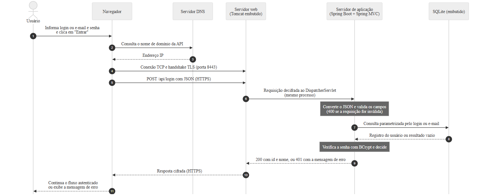

## 1.8 Fluxo completo de processamento de uma requisição

Este item reúne os componentes descritos nos itens 1.2 a 1.7 no percurso completo de uma autenticação, desde o momento em que o usuário envia as credenciais até a exibição do resultado. A Figura 2 apresenta esse percurso como um diagrama de sequência, em que cada mensagem trocada entre os componentes é numerada; os parágrafos a seguir acompanham essa numeração, remetendo aos itens em que cada etapa é detalhada.

**Figura 2 – Sequência de processamento de uma requisição de autenticação**

Fonte: elaborada pelos autores com auxílio de IA (ANTHROPIC, 2026d).

O percurso começa com a tela de login já exibida pelo navegador (item 1.2). Quando o usuário informa o identificador, login ou e-mail, e a senha e clica em "Entrar" (mensagem 1), o navegador precisa do endereço IP do servidor da API e o obtém por meio do DNS (mensagens 2 e 3, item 1.3). Em seguida, estabelece a conexão TCP e o canal seguro TLS com o Tomcat, na porta 8443 (mensagem 4, item 1.4), e, por essa conexão, envia a requisição POST /api/login com as credenciais em JSON, cifrada pelo canal TLS (mensagem 5, itens 1.2 e 1.4).

O Tomcat, embutido na aplicação, decifra a requisição, interpreta a mensagem HTTP e a entrega ao DispatcherServlet do Spring MVC, por uma chamada dentro do mesmo processo Java (mensagem 6, item 1.5). O Spring converte o JSON em objeto e valida os campos; se a requisição estiver malformada, a resposta 400 é produzida nesse ponto, sem consulta ao banco. Com os campos válidos, a lógica de autenticação consulta o SQLite, também embutido no mesmo processo, por meio de uma consulta parametrizada pelo login ou pelo e-mail (mensagem 7, itens 1.6 e 1.7). O SQLite devolve o registro do usuário, se o identificador estiver cadastrado, ou um resultado vazio (mensagem 8). Com esse resultado, a aplicação verifica a senha informada com o BCrypt e decide se a autenticação foi bem-sucedida, segundo a lógica detalhada na Seção 2 (itens 2.2.3 e 2.2.4).

A resposta percorre então o caminho inverso. A aplicação devolve ao Tomcat o código 200, com a identificação do usuário, ou o código 401, com a mensagem genérica de erro (mensagem 9, item 1.6); o Tomcat cifra a resposta e a envia ao navegador pelo canal seguro (mensagem 10, item 1.5); e o navegador, de acordo com o código recebido, continua o fluxo com o usuário autenticado ou exibe a mensagem de erro (mensagem 11, item 1.2).

Nas requisições seguintes ao mesmo domínio, o endereço IP já está em cache e a conexão segura pode ser reaproveitada, de modo que as mensagens 2 a 4 deixam de ser necessárias. Em todo o percurso, apenas o Tomcat recebe conexões vindas da rede, as credenciais só trafegam fora do servidor de forma cifrada e a passagem entre servidor web, servidor de aplicação e banco de dados ocorre dentro de um único processo, sem nova comunicação pela rede (ANTHROPIC, 2026d).
